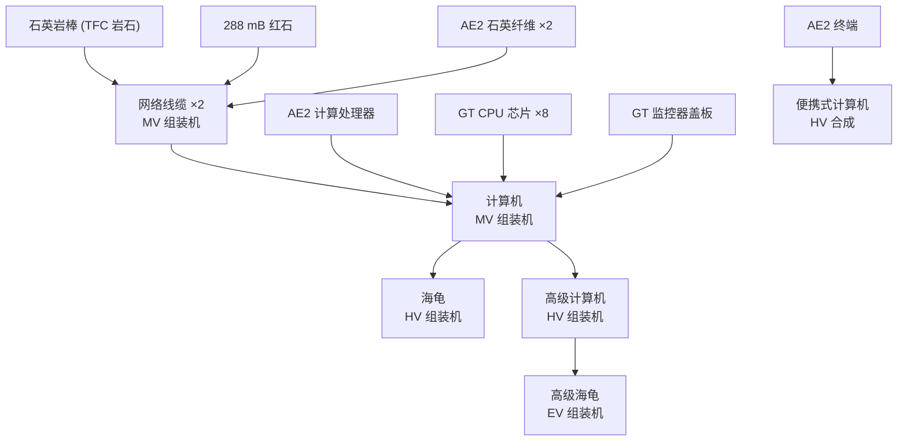

# Progression

<VersionPill show-core />

Computers sit **after** AE2 automation and MV GregTech. Reading the recipe graph backwards gives the actual entry requirement:

## Requirements by milestone

| You want | You need first |
| --- | --- |
| Network cable | MV assembler, quartzite (TFC rock), AE2 quartz fibre, redstone fluid |
| Computer | MV assembler, AE2 calculation processors, GT CPU chips, monitor cover |
| Monitor | MgB₂ wire (MV), AE2 calculation processor, MV casing |
| Turtle | HV assembler, steel crate, HV conveyor/robot arm/emitter/sensor/fluid regulator |
| Advanced computer | HV assembler, EV circuits, 12× GT SoC |
| Advanced turtle | EV assembler, aluminium crate, EV components |
| Pocket computer | AE2 terminal + wireless receiver, HV battery and emitter, titanium plate |
| Disk | AE2 blank pattern + TFC dye, ULV chemical bath |

## Why so late

The quest chapter states the reasoning directly: a basic computer is "little more than an advanced logic gate and item sorter" until you have peripherals, and TFGM wants the computer to arrive when you already have AE2 logistics and GregTech power — the point where wrapping machines as peripherals is actually useful.

## What you skip

Because the recipes are rebuilt, some upstream shortcuts are gone:

- No vanilla redstone + iron + glass computer.
- No cheap turtle from a computer + iron.
- No `printed_pages`/`printed_book` rebuild — those two keep their vanilla recipe, which is the only CC:T recipe TFGM leaves alone.

## Creative-only items

`computercraft:computer_command` still exists and is not craftable, matching upstream. `computercraft:treasure_disk` also has no recipe; it is the loot disk.
