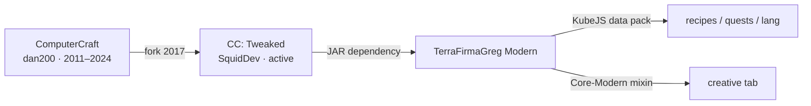

# Upstream and versioning

<VersionPill show-core />

## The chain

**Original upstream**: `dan200/ComputerCraft`. Daniel Ratcliffe handed the source to the public in 2017; the repository has one release (1.79) and its last commit is 2024-05-13. It is not developed.

**The upstream you actually run**: [`cc-tweaked/CC-Tweaked`](https://github.com/cc-tweaked/CC-Tweaked), maintained by SquidDev and contributors, documented at [tweaked.cc](https://tweaked.cc/). Default branch `mc-1.20.x`; active releases for 1.20.1, 1.21.1 and the newer `26.x` Minecraft versioning.

## Where this release sits

<ModPins />

TFGM ships `cc-tweaked-1.20.1-forge-1.121.0.jar`. That version matters: 1.121.0 is the release that closes [GHSA-g5h5-fp5g-fmx4](https://github.com/cc-tweaked/CC-Tweaked/security/advisories/GHSA-g5h5-fp5g-fmx4), a high-severity bypass of the `$private` HTTP rule (SSRF into loopback, Docker socket, LAN and cloud metadata). TFGM 0.13.18 lists it as the headline fix in its changelog.

## Two API breaks TFGM had to absorb

| CC:T change | TFGM response |
| --- | --- |
| `TurtleUpgrades.getVanillaUpgrades()` removed in 1.121.0 | The `ModRegistryMixin` injection point moved to `@At("HEAD")` so it no longer targets a deleted method (Core 0.9.33, commit `a49e88c4`) |
| Turtle/pocket upgrade NBT rewritten to keep the equipped item (`RightUpgradeItem` / `UpgradeInfo`) | Turtles crafted with upgrades before 1.121.0 need re-upgrading; recipes reference upgrades by ID, so crafting still works |

Version drift is the main long-term risk: TFGM 0.13.17 pinned 1.116.1, which meant ~16 months of upstream fixes (including the security advisory) were missing until 0.13.18.

## Upstream release cadence

Roughly quarterly on the 1.20.1 line:

| Version | Date | Notable |
| --- | --- | --- |
| 1.116.1 | 2025-07-12 | |
| 1.117.1 | 2026-02-22 | |
| 1.118.0 | 2026-04-26 | |
| 1.119.0 | 2026-05-16 | |
| 1.120.0 | 2026-06-15 | |
| 1.120.2 | 2026-08-08 | |
| **1.121.0** | **2026-11-03** | SSRF fix, upgrade API rewrite |

## License

CC: Tweaked is MPL-2.0; upstream ComputerCraft code carries `LicenseRef-CCPL`. TerraFirmaGreg's KubeJS and quest content is governed by the Modpack-Modern licence. See [NOTICE](https://github.com/TerraFirmaGreg-Translation-CN/cctweaked4tfgm/blob/main/NOTICE.md).
