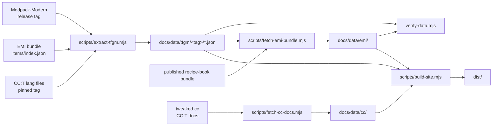

# Data pipeline

Every number on this site is generated. Nothing is transcribed by hand except this prose.



## What the extractor does

`scripts/extract-tfgm.mjs` takes a Modpack-Modern checkout or release tag and produces `docs/data/tfgm/<tag>/`:

| File | Source | Notes |
| --- | --- | --- |
| `meta.json` | `pakku-lock.json` | TFGM tag, commit, CC:T/AP/Core versions, hashes |
| `recipes.json` | `kubejs/server_scripts/{computer_craft,advancedperipherals}/recipes.js` | **Executed**, not parsed |
| `turtle-upgrades.json` | `kubejs/server_scripts/computer_craft/data.js` + item registry | Material set derived from shipped items |
| `quests.json` | `config/ftbquests/quests/chapters/cc.snbt` + `tfg/lang/*/quests/computer.json` | Dependency graph preserved |
| `config.json` | `defaultconfigs/computercraft-server.toml` | Diffed against CC:T defaults |
| `lang.json` | `kubejs/assets/computercraft/lang/*.json` | Coverage against the pinned CC:T |
| `labels.json` | published `items-lang/*.json` | Pruned to the referenced ids |

## Why the recipes are executed

The KubeJS scripts are plain JavaScript against a fluent DSL. Parsing them with regexes would break the moment someone reformats a recipe, and it cannot evaluate the `for` loops that generate the 16 disk recipes or the per-material turtle upgrades.

So the extractor runs each file in a `node:vm` context with a recording mock (`FakeForge`) implementing `event.recipes.gtceu.*`, `event.shaped`, `event.shapeless` and `event.remove`. Real recipe chains land in an array:

```
event.recipes.gtceu.assembler('computercraft:assembler/computer_normal')
  .itemInputs(...).circuit(4).duration(1200).EUt(GTValues.VA[GTValues.MV])
```

becomes

```json
{
  "kind": "gtceu.assembler",
  "id": "computercraft:assembler/computer_normal",
  "tier": "MV",
  "euPerTick": 120,
  "duration": 1200,
  "circuit": 4,
  "inputs": [ /* parsed ingredients */ ],
  "outputs": [],
  "source": { "file": "kubejs/server_scripts/computer_craft/recipes.js", "line": 104 }
}
```

The tier is derived from `EUt` against `GTValues.VA`, so a tier constant change in the script is reflected automatically.

## Turtle upgrades come from the item registry

TFGM does not list its materials; it iterates `forEachMaterial(material => …)`. To know which materials GT actually registered, the extractor reads `items/index.json` from the published EMI bundle of the same release and keeps the `*_<toolType>` ids. That is why the result tracks the pack's real material set (20 materials, 73 upgrades) instead of a guessed list.

## EMI layouts and icons

`scripts/fetch-emi-bundle.mjs` takes the CC/AP rows from `recipes.json`, looks up each output item in the published TerraFirmaGreg recipe-book bundle (`bundles/tfg-<tag>/items/`), and copies the matching EMI layouts. It also packs only the 32×32 icon cells those layouts can show into one local atlas, prunes the tag and item-label tables, and writes `docs/data/emi/` plus `docs/data/emi-map.json`.

The site therefore renders the game's own recipe cards through `emi-recipe-renderer`, with no link to another project, while the committed bundle stays around 1.4 MB.

## CC:T documentation mirror

`scripts/fetch-cc-docs.mjs` reads the rendered page bodies from `tweaked.cc/mc-1.20.x` for the CC:T version pinned by the release, rewrites relative links to this site's clean URLs and caches the referenced item icons under `docs/public/images/`. The result is `docs/data/cc/pages.json` plus 95 page fragments, exactly the upstream reference with TerraFirmaGreg callouts inserted where recipes or turtle upgrades differ.

## Verification gate

`scripts/verify-data.mjs` runs before every build and fails on:

- a missing or stale `docs/data/latest.json`
- a recipe whose `tier` disagrees with its `euPerTick`
- a turtle upgrade whose tool item has no material or type
- a quest whose dependency id is not in the chapter
- a config key present in TFGM but absent from the upstream default table
- a recipe with no EMI mapping, or a missing card image in `docs/data/emi/`
- a mirrored CC:T page missing, or a CC:T version mismatch in `docs/data/cc/pages.json`

The config check is what keeps the "no overrides" claim honest: add an override without teaching the extractor about it, and the build fails.

## Regenerating

```bash
# 1. cache upstream inputs for the release you target
node scripts/fetch-item-index.mjs --modpack-tag 0.13.18 --cc-version 1.121.0

# 2. point the extractor at a checkout (or pass a tag to clone it)
node scripts/extract-tfgm.mjs --modpack .cache/modpack-0.13.18

# 3. mirror the CC:T documentation for that version
node scripts/fetch-cc-docs.mjs --version 1.121.0

# 4. extract the matching EMI layouts and icons
node scripts/fetch-emi-bundle.mjs

# 5. verify and build
npm run build
```

CI runs the same five steps against the latest Modpack-Modern release tag on a schedule.
