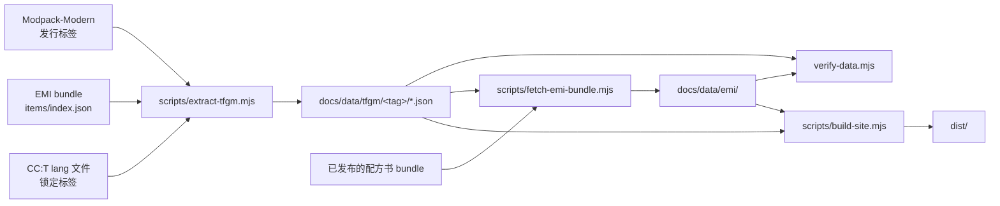

# 数据流水线

本站的每个数字都是生成的。除正文外没有任何人工抄录。



## 提取器做了什么

`scripts/extract-tfgm.mjs` 接受一个 Modpack-Modern 检出目录或发行标签，输出 `docs/data/tfgm/<tag>/`：

| 文件 | 来源 | 说明 |
| --- | --- | --- |
| `meta.json` | `pakku-lock.json` | 群峦格雷标签、提交、CC:T/AP/Core 版本与哈希 |
| `recipes.json` | `kubejs/server_scripts/{computer_craft,advancedperipherals}/recipes.js` | **执行**而非解析 |
| `turtle-upgrades.json` | `kubejs/server_scripts/computer_craft/data.js` + 物品注册表 | 材料集来自实际物品 |
| `quests.json` | `config/ftbquests/quests/chapters/cc.snbt` + `tfg/lang/*/quests/computer.json` | 保留依赖图 |
| `config.json` | `defaultconfigs/computercraft-server.toml` | 与 CC:T 默认值对比 |
| `lang.json` | `kubejs/assets/computercraft/lang/*.json` | 对照锁定的 CC:T 统计覆盖率 |
| `labels.json` | 已发布的 `items-lang/*.json` | 裁剪到被引用的 id |

## 为什么配方是“执行”出来的

KubeJS 脚本是针对流式 DSL 的普通 JavaScript。用正则解析会在有人重排配方时立刻失效，而且无法求值生成 16 种软盘配方的 `for` 循环或按材料的循环。

所以提取器把每个文件放进 `node:vm` 上下文，用实现 `event.recipes.gtceu.*`、`event.shaped`、`event.shapeless`、`event.remove` 的记录型 mock（`FakeForge`）来跑。真实配方链落进数组：

```
event.recipes.gtceu.assembler('computercraft:assembler/computer_normal')
  .itemInputs(...).circuit(4).duration(1200).EUt(GTValues.VA[GTValues.MV])
```

变成

```json
{
  "kind": "gtceu.assembler",
  "id": "computercraft:assembler/computer_normal",
  "tier": "MV",
  "euPerTick": 120,
  "duration": 1200,
  "circuit": 4,
  "inputs": [ /* 解析后的原料 */ ],
  "outputs": [],
  "source": { "file": "kubejs/server_scripts/computer_craft/recipes.js", "line": 104 }
}
```

电压等级由 `EUt` 对 `GTValues.VA` 反查得出，所以脚本里换了等级常量，页面会自动跟上。

## 海龟升级来自物品注册表

群峦格雷没有列出材料，而是 `forEachMaterial(material => …)` 遍历。为了知道格雷实际注册了哪些材料，提取器读取同一版本已发布 EMI bundle 中的 `items/index.json`，保留 `*_<工具类型>` 的 id。这就是为什么结果反映的是整合包真实材料集（20 种材料、73 个升级），而不是猜的列表。

## EMI 布局与图标

`scripts/fetch-emi-bundle.mjs` 从 `recipes.json` 取出 CC/AP 配方行，在已发布的群峦格雷配方书 bundle（`bundles/tfg-<tag>/items/`）里查找每个产物对应的 EMI 布局并复制过来。它还会把这些布局可能显示的 32×32 图标格打包成本地图集、裁剪标签与物品名表，写出 `docs/data/emi/` 和 `docs/data/emi-map.json`。

因此本站通过 `emi-recipe-renderer` 渲染游戏自己的配方卡，不跳转到别的项目，而提交进仓库的 bundle 只有约 1.4 MB。

## 构建前的校验

`scripts/verify-data.mjs` 在每次构建前运行，以下情况判定失败：

- `docs/data/latest.json` 缺失或过期
- 某个配方的 `tier` 与其 `euPerTick` 不一致
- 某个海龟升级的工具物品没有对应材料或类型
- 某个任务的依赖 id 不在章节内
- TFGM 配置里出现上游默认表中没有的键
- 某个配方没有 EMI 映射，或 `docs/data/emi/` 里缺少对应卡片图

配置检查是“零覆盖”这个结论的保险：如果有人加了覆盖却没让提取器知道，构建会失败。

## 重新生成

```bash
# 1. 缓存目标发行版的上游输入
node scripts/fetch-item-index.mjs --modpack-tag 0.13.18 --cc-version 1.121.0

# 2. 指向检出目录（或直接传标签让它克隆）
node scripts/extract-tfgm.mjs --modpack .cache/modpack-0.13.18

# 3. 抽取对应的 EMI 布局与图标
node scripts/fetch-emi-bundle.mjs

# 4. 校验并构建
npm run build
```

CI 会按计划对最新的 Modpack-Modern 发行标签执行同样四步。
