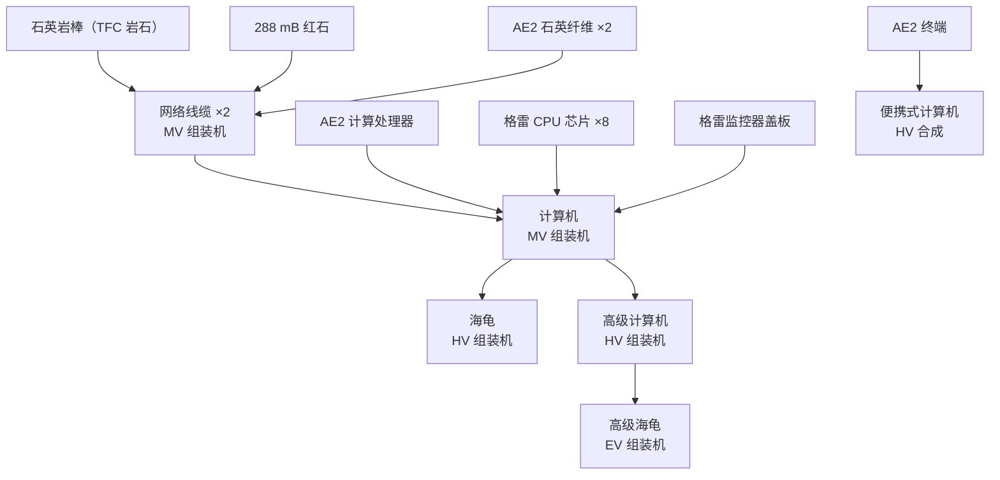

# 进度

<VersionPill show-core />

计算机排在 **AE2 自动化之后**、MV 格雷阶段。倒着读配方图，就能得到真实的入门条件：

## 按里程碑列出的需求

| 目标 | 前置 |
| --- | --- |
| 网络线缆 | MV 组装机、石英岩（TFC 岩石）、AE2 石英纤维、红石流体 |
| 计算机 | MV 组装机、AE2 计算处理器、格雷 CPU 芯片、监控器盖板 |
| 显示器 | MgB₂ 线（MV）、AE2 计算处理器、MV 机壳 |
| 海龟 | HV 组装机、钢制板条箱、HV 传送带/机械臂/发射器/传感器/流体调节器 |
| 高级计算机 | HV 组装机、EV 电路、12 个格雷 SoC |
| 高级海龟 | EV 组装机、铝制板条箱、EV 部件 |
| 便携式计算机 | AE2 终端 + 无线接收器、HV 电池与发射器、钛板 |
| 软盘 | AE2 空白样板 + TFC 染料、ULV 化学浸洗机 |

## 为什么这么晚

任务章节直接写了理由：在拥有外设之前，基础计算机“不过是一个高级逻辑门和物品分拣器”，而群峦格雷希望计算机出现在你已经有 AE2 物流和格雷电力的时候——那时把机器包装成外设才真正有用。

## 被取消的捷径

因为配方是重建的，一些上游捷径不复存在：

- 没有原版的红石 + 铁 + 玻璃计算机。
- 没有“计算机 + 铁”的廉价海龟。
- `printed_pages` / `printed_book` 不重建——这两个是 CC:T 中群峦格雷唯一保留原版配方的物品。

## 创造模式专用物品

`computercraft:computer_command` 仍然存在且不可合成，与上游一致。`computercraft:treasure_disk` 也没有配方；它是战利品软盘。
