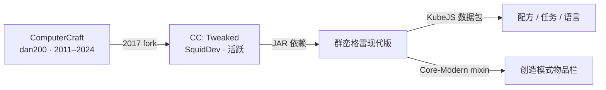

# 上游与版本

<VersionPill show-core />

## 谱系

**原始上游**：`dan200/ComputerCraft`。Daniel Ratcliffe 在 2017 年公开源码；仓库只有一个 release（1.79），最后一次提交是 2024-05-13。它已停止开发。

**你实际在用的上游**：[`cc-tweaked/CC-Tweaked`](https://github.com/cc-tweaked/CC-Tweaked)，由 SquidDev 与贡献者维护，文档在 [tweaked.cc](https://tweaked.cc/)。默认分支 `mc-1.20.x`；为 1.20.1、1.21.1 以及新的 `26.x` Minecraft 版本号持续发版。

## 本版本的位置

<ModPins />

群峦格雷锁定 `cc-tweaked-1.20.1-forge-1.121.0.jar`。这个版本号很关键：1.121.0 修复了 [GHSA-g5h5-fp5g-fmx4](https://github.com/cc-tweaked/CC-Tweaked/security/advisories/GHSA-g5h5-fp5g-fmx4)，一个高危的 `$private` HTTP 规则绕过（SSRF 可达回环、Docker 套接字、局域网和云元数据服务）。群峦格雷 0.13.18 的更新日志把它列为头条修复。

## 群峦格雷不得不吸收的两次 API 变更

| CC:T 变更 | 群峦格雷的应对 |
| --- | --- |
| 1.121.0 删除 `TurtleUpgrades.getVanillaUpgrades()` | `ModRegistryMixin` 的注入点改为 `@At("HEAD")`，不再指向被删除的方法（Core 0.9.33，提交 `a49e88c4`） |
| 海龟/便携机升级 NBT 重写为保留所装物品（`RightUpgradeItem` / `UpgradeInfo`） | 1.121.0 之前装好升级的海龟需要重新装；配方按 ID 引用升级，合成不受影响 |

版本滞后是主要的长期风险：群峦格雷 0.13.17 锁的是 1.116.1，意味着约 16 个月的上游修复（包括那条安全公告）直到 0.13.18 才补上。

## 上游发版节奏

1.20.1 线上大致每季度一版：

| 版本 | 日期 | 要点 |
| --- | --- | --- |
| 1.116.1 | 2025-07-12 | |
| 1.117.1 | 2026-02-22 | |
| 1.118.0 | 2026-04-26 | |
| 1.119.0 | 2026-05-16 | |
| 1.120.0 | 2026-06-15 | |
| 1.120.2 | 2026-08-08 | |
| **1.121.0** | **2026-11-03** | SSRF 修复、升级 API 重写 |

## 许可

CC: Tweaked 使用 MPL-2.0；上游 ComputerCraft 代码带 `LicenseRef-CCPL`。群峦格雷的 KubeJS 与任务内容受 Modpack-Modern 的许可约束。详见 [NOTICE](https://github.com/TerraFirmaGreg-Translation-CN/cctweaked4tfgm/blob/main/NOTICE.md)。
